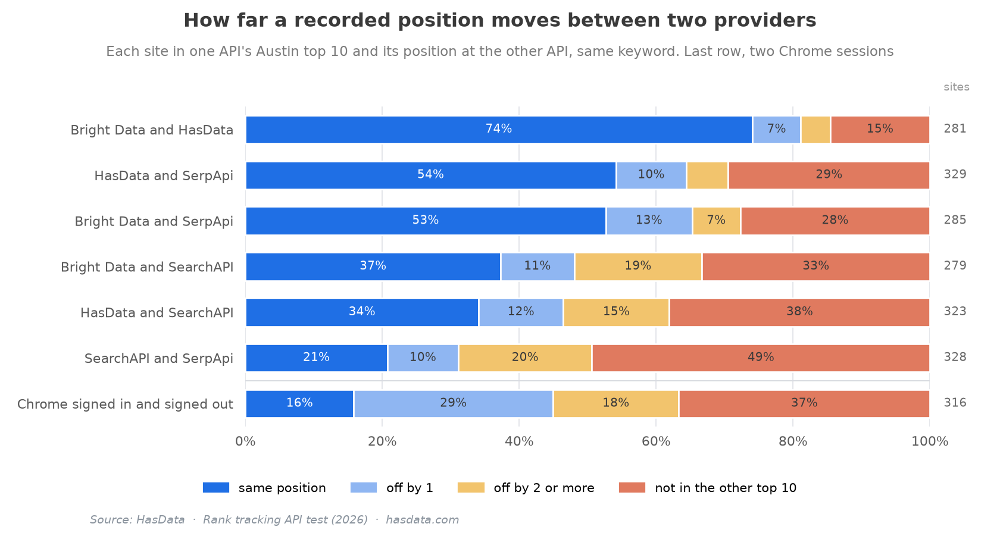
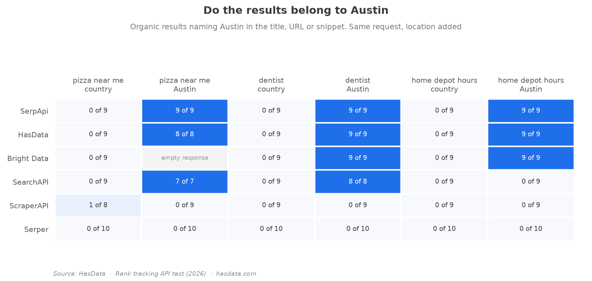
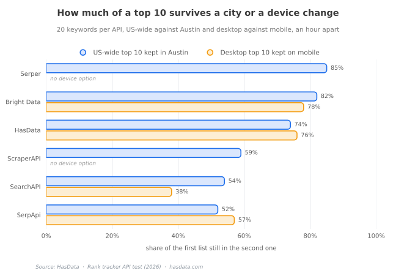

# Rank Tracker API Benchmark (Dataset)


The data behind [Best Rank Tracker APIs Tested on 20 Keywords](https://hasdata.com/blog/rank-tracking-apis?utm_source=github&utm_medium=syndication&utm_campaign=rank-tracking-apis&utm_content=readme), a HasData comparison of seven rank tracker APIs. The same 20 keywords went to every API US-wide on desktop, with the city set to Austin, Texas, and on mobile. Two Chrome windows loaded the same pages within the same minute as a reference. This repository holds every normalized response, the two browser sessions, the scripts that rebuild the article's tables, the cost model behind its price section and the Python tracker from the article.

## Contents

- [Key Findings](#key-findings)
- [The Sample](#the-sample)
- [Method](#method)
- [Files](#files)
- [File Schemas](#file-schemas)
- [Reproducing the Tables](#reproducing-the-tables)
- [Scope of This Release](#scope-of-this-release)
- [License](#license)
- [How to Cite](#how-to-cite)
- [Disclaimer](#disclaimer)
- [More Resources](#more-resources)

## Key Findings

Two live Google searches disagree more than two APIs do. The two Chrome windows, one signed in to Google and one with a fresh profile, gave the same position to 16% of the sites in each other's top 10, with 29% off by one place and 37% missing from the other window's top 10. The closest pair of APIs, Bright Data and HasData, agreed on 74% of positions in Austin. HasData and SerpApi agreed on 54%, Bright Data and SerpApi on 53%. The pairs with SearchAPI run from 37% down to 21%, because its Austin pages mixed in other cities.



Four of the seven APIs applied the city. On the three local keywords every Austin result from SerpApi, HasData and Bright Data named Austin in its title, URL or snippet, with one empty Bright Data response on "pizza near me". SearchAPI named Austin on two of the three keywords and returned the US-wide page for "home depot hours". ScraperAPI and Serper returned pages for other towns, and a recheck of Serper with both location spellings on 2026-10-22 returned Houston, Fort Mill, Conway and Boston results again.



Setting the city moved more than the local keywords. Comparing each API's US-wide top 10 with its own Austin top 10 for the same keyword, about an hour apart, SerpApi kept 52% and SearchAPI 54%, HasData kept 74% and Bright Data 82%. Serper kept 85%, and since the city didn't take, its figure is an hour of drift with no location change. On mobile, SearchAPI kept 38% of its desktop top 10, SerpApi 57%, HasData 76% and Bright Data 78%, and the mobile page held one result fewer at the median.



Response time on the Austin pass ran from a median of 1.6 s at Serper to 10.3 s at Bright Data. SerpApi and HasData sat at 2.3 s and 2.6 s with a slowest request of 16.4 s each, SearchAPI at 4.1 s, ScraperAPI at 4.4 s.

## The Sample

The keyword list is in `data/keywords.jsonl`. Ten keywords are about SEO and SERP tools, three are local ("pizza near me", "dentist", "home depot hours") and seven are everyday searches such as "tesla stock" and "how to tie a tie".

The three passes ran on 2026-10-15. The US-wide desktop pass (`country`) started at 12:44 UTC, the Austin pass (`austin`) at 13:57 and the mobile pass (`mobile`) at 14:07. Each API got the keywords one at a time with `gl=us` and `hl=en`. ScraperAPI's two passes ran the same afternoon from 17:01, and Scrapingdog's US-wide pass ran at 14:22. SearchAPI's Austin and mobile records were refreshed on 2026-10-22, and so were ScraperAPI's three local keywords in Austin, which are in `austin-rerun`. The Serper recheck with both spellings of the location also dates from 2026-10-22.

The two Chrome windows loaded the US-wide pages within the same minute. One was signed in to a Google account, one ran a fresh profile. In the Austin pass both windows stopped on a Google challenge page after the third keyword, and the remaining records carry that error and no results. No challenge was answered or worked around, so the Chrome pair is read on the US-wide pass only.

## Method

Positions count organic results only. Ads, the map pack, People Also Ask and the other blocks are listed under `norm.features` and get no position. A site is identified by its host with `www.` removed, and a host that ranks twice counts twice, so the second occurrence is a separate key.

For the pair table, every site in one API's Austin top 10 is looked up in the other API's top 10 for the same keyword, in both directions, and binned as same position, off by one, off by two or more, or missing. For the retention tables, the share is the size of the intersection of the two top 10s divided by the smaller of the two lists, averaged over the keywords that have both pages. A result names Austin when the word appears in its title, URL or snippet. Response time is the full wait until the body arrived, and a request past 300 seconds counted as a failure.

## Files

| File | Rows | What it holds |
|---|---|---|
| `data/keywords.jsonl` | 20 | The keyword list, one object per line with `id`, `q` and `intent` |
| `data/raw/country/` | 178 | US-wide desktop pass, seven APIs and the two Chrome windows, one JSON file per keyword. Scrapingdog has 18 |
| `data/raw/austin/` | 160 | Austin pass, six APIs at 20 keywords and the two Chrome windows at 20 files each, three of which carry results |
| `data/raw/mobile/` | 80 | US-wide mobile pass for Bright Data, HasData, SearchAPI and SerpApi |
| `data/raw/austin-rerun/` | 3 | ScraperAPI, the three local keywords in Austin on 2026-10-22 |
| `data/serper-location-recheck.json` | 6 | Serper's raw responses for the three local keywords with two spellings of the Austin location |
| `charts/` | 3 | The three charts above |
| `scripts/summarize.py` | | Rebuilds the five tables from `data/raw`, standard library only |
| `scripts/cost_model.py` | | Cheapest plan per vendor from 20 to 193,500 keywords a day, monthly and annual, from the price ladders of 2026-10-22 |
| `scripts/rank_tracker.py` | | The tracker from the article, unchanged |

The vendor folders are `hasdata`, `serpapi`, `brightdata`, `searchapi`, `scrapingdog`, `serper` and `scraperapi`. The two browser sessions are `real_clean` (signed out) and `real_account` (signed in).

## File Schemas

Each file in `data/raw` is one request. `vendor` and `task` name the API and the job (`google_web` throughout), `started` is the UTC timestamp, `status` the HTTP status (`null` when no response arrived), `seconds` the full wait, `bytes` the body size, `ttfb` the time to the first byte where the client measured it, and `error` the failure text or `null`. `request` holds the method, URL, query parameters and JSON body as sent, with the API key replaced by `<hidden>`. `item` repeats the keyword with its `id`, `q`, `intent`, `gl`, `hl`, `device` and `location`.

`norm` is the same shape for every API. `organic` is a list of results with `pos`, `title`, `url` and `snippet`, plus `host` and `crumb` where the source had them. `features` lists the other blocks on the page by name, and `aio_present` says whether an AI Overview was there. Raw vendor bodies are not included, so a vendor's own field names don't appear here.

`data/serper-location-recheck.json` is keyed by keyword id and location spelling (`k11|Austin,Texas,United States`) and holds Serper's response as returned, with `searchParameters`, `organic`, `relatedSearches` and `credits`.

## Reproducing the Tables

```bash
git clone https://github.com/HasData/rank-tracker-api-benchmark.git
cd rank-tracker-api-benchmark
python scripts/summarize.py
python scripts/cost_model.py
```

`summarize.py` prints the Austin naming grid, the retention shares, the pair bins, the mobile shares with the organic counts per page and the response-time percentiles, the numbers the article's tables carry. `cost_model.py` prints the cheapest vendor per daily volume. `rank_tracker.py` needs a HasData key in `HASDATA_API_KEY` and `requests`. Four checks cost 20 credits.

## Scope of This Release

The release holds normalized responses, not the bodies the APIs returned. Titles, URLs and snippets are the published search results of 2026-10-15 and 2026-10-22 and can contain contact details that Google showed on the page. Every API key is replaced by `<hidden>`. The Chrome records carry the Google request as the browser sent it, with the `uule` parameter for Austin. Scrapingdog is in the US-wide pass only, and the article's figures for its city and mobile options come from a separate run that is not part of this release.

## License

The data, charts and scripts are released under [CC BY 4.0](LICENSE). Use them with attribution to [HasData](https://hasdata.com/?utm_source=github&utm_medium=syndication&utm_campaign=rank-tracking-apis&utm_content=license) and a link to the [comparison](https://hasdata.com/blog/rank-tracking-apis?utm_source=github&utm_medium=syndication&utm_campaign=rank-tracking-apis&utm_content=license).

## How to Cite

> HasData. (2026). *Best Rank Tracker APIs Tested on 20 Keywords*. https://hasdata.com/blog/rank-tracking-apis

```bibtex
@misc{hasdata_rank_tracker_api_benchmark,
  author       = {{HasData}},
  title        = {Best Rank Tracker APIs Tested on 20 Keywords},
  year         = {2026},
  howpublished = {\url{https://hasdata.com/blog/rank-tracking-apis}}
}
```

A `CITATION.cff` file is in the repository root.

## Disclaimer

HasData is one of the seven APIs in the comparison. Every API got the same keywords, the same parameters and the same scoring, and the scripts here reproduce every table from the stored responses, so the comparison can be checked without trusting the author. Prices in `cost_model.py` are the vendors' public ladders on 2026-10-22 and change without notice.

## More Resources

- [Best Rank Tracker APIs Tested on 20 Keywords](https://hasdata.com/blog/rank-tracking-apis?utm_source=github&utm_medium=syndication&utm_campaign=rank-tracking-apis&utm_content=rank-tracking-apis-readme), the comparison this data belongs to
- [Best SERP APIs](https://hasdata.com/blog/best-serp-apis?utm_source=github&utm_medium=syndication&utm_campaign=rank-tracking-apis&utm_content=rank-tracking-apis-readme), the same keyword set against the SERP APIs
- [Google AI Overview study](https://hasdata.com/blog/google-ai-overview-study?utm_source=github&utm_medium=syndication&utm_campaign=rank-tracking-apis&utm_content=rank-tracking-apis-readme), how often an AI Overview cites position 1
- [HasData Google SERP API](https://hasdata.com/apis/google-serp-api?utm_source=github&utm_medium=syndication&utm_campaign=rank-tracking-apis&utm_content=rank-tracking-apis-readme), the endpoint behind the tracker script
